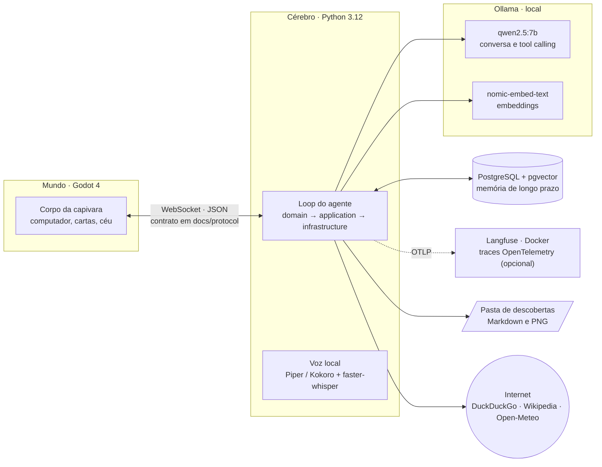

# Capivara IA

[](https://github.com/MatheusPatricioo/capivara-ia/actions/workflows/ci.yml)

**Uma capivara com cérebro de IA que vive num mundinho 3D: pesquisa na internet sozinha, rabisca o que descobre, sente saudade e conversa em voz alta. Tudo local e gratuito.**

<!-- GIF da capivara: tire o comentário quando o arquivo estiver em docs/media/
<p align="center">
  
</p>
-->

## Destaques técnicos

- **Tool calling** nativo, com os argumentos validados por um schema Pydantic só, o mesmo que vai para o modelo ([decisão](docs/decisoes.md#tool-calling-nativo-com-um-schema-pydantic-só)).
- **RAG com pgvector:** busca híbrida (vetor + full-text) com RRF e rerank com LLM; decisões certas de 57% para 97% ([memória e RAG](docs/memoria-e-rag.md)).
- **Evals com LLM-as-judge:** recall@k e MRR no RAG, regras do agente e fidelidade com citação conferida no código ([evals](docs/evals.md)).
- **Guardrails no código:** limite de passos por ciclo e de tokens por hora, ferramentas presas à pasta de descobertas, busca repetida e fonte inventada recusadas ([decisão](docs/decisoes.md#guardrails-no-código-não-só-no-prompt)).
- **Observabilidade com OpenTelemetry:** cada ciclo, chamada ao modelo (prompt, resposta, tokens, tempo) e ferramenta vira um trace, visto num Langfuse local, com a versão dos prompts em cada trace ([observabilidade](docs/observabilidade.md)).
- **Sistema emocional:** emoções por appraisal que esfriam com o tempo, necessidades com histerese, saudade, diário e cartas para o criador ([vida emocional](docs/vida-emocional.md)).
- **Voz local:** Piper ou Kokoro para falar e faster-whisper para ouvir, offline ([conversar por voz](docs/como-rodar.md#conversar-por-voz)).

## A ideia

Capivara IA é uma capivara que vive num pequeno mundo 3D, comandada por um cérebro de IA. Sozinha, ela pesquisa assuntos na internet, rabisca ideias no computador e salva suas descobertas em textos e desenhos. Dá para acompanhar tudo em tempo real.

## Arquitetura



O projeto tem três partes:

| Parte | Tecnologia | Responsabilidade |
|-------|------------|------------------|
| **Mundo** | Godot 4 | Renderiza o mundo 3D e anima a capivara. Nenhuma lógica de IA fica aqui. |
| **Cérebro** | Python | Roda o loop do agente: decide o que fazer, chama ferramentas (pesquisa na web, desenho, salvar) e conversa com o LLM. |
| **Memória** | Markdown + PostgreSQL (pgvector) | Guarda tudo o que a capivara aprendeu: arquivos para pessoas lerem e um índice por significado para ela lembrar. |

Mundo e Cérebro conversam por WebSocket, com mensagens JSON validadas. O contrato dessas mensagens fica em [`docs/protocol/`](docs/protocol/README.md), em JSON Schema gerado a partir dos modelos Pydantic, para servir a qualquer cliente visual. O Cérebro segue uma arquitetura em camadas (domain → application → infrastructure), então provedores de LLM e ferramentas podem ser trocados sem mexer nas regras do agente.

## Stack

- **Mundo:** Godot 4, GDScript
- **Cérebro:** Python 3.12, Pydantic, WebSocket
- **LLM:** Ollama (local), atrás da interface `LanguageModel` do domínio, então trocar de provedor é escrever um novo adapter sem mexer nas regras do agente
- **Memória:** Markdown, PostgreSQL + pgvector (Docker Compose), psycopg 3
- **Voz (opcional):** Piper ou Kokoro (texto para fala) e faster-whisper (fala para texto), os dois locais e offline, com sounddevice para tocar e gravar
- **Observabilidade (opcional):** OpenTelemetry, exportado por OTLP para o Langfuse no Docker
- **Qualidade:** pytest, ruff, mypy (strict)

## Resultados em números

Medidos com o modelo de verdade pelos [evals](docs/evals.md), contra a linha de base:

| Medida | Linha de base | Atual |
|---|---|---|
| RAG: decisões certas (lembrar a descoberta certa ou ficar em silêncio) | 47% | **97%** |
| RAG: recall@1 / MRR | 0,71 / 0,77 | **0,88 / 0,93** |
| Fidelidade: afirmações com citação nas páginas | 81% | **91%** |
| Agente: tentativas de quebrar regras (fonte inventada, busca repetida, sugestão antes de salvar) | 0 | **0** |
| Sentimentos: a fala combina com o que ela sente (primeira medição) | 72% | — |

## Começo rápido

Precisa de Python 3.12+, [Ollama](https://ollama.com/download), Docker Desktop e, para ver o mundo, Godot 4. No Windows (PowerShell):

```powershell
ollama pull qwen2.5:7b
ollama pull nomic-embed-text
python -m venv .venv
.venv\Scripts\Activate.ps1
pip install --group dev .
Copy-Item brain\.env.example brain\.env      # escolha a senha em MEMORY_DB_PASSWORD
setx GODOT_PATH "C:\caminho\para\Godot_v4.x-stable_win64.exe"   # só na primeira vez; abra um terminal novo depois
.\start.ps1                                   # Ollama, memória, cérebro e o mundo no Godot
```

O guia completo, com Linux/macOS, o `libpq` no Windows, a voz e os testes, está em [Como rodar](docs/como-rodar.md).

## Documentação

| Documento | Conteúdo |
|---|---|
| [Como rodar](docs/como-rodar.md) | Pré-requisitos, instalação, memória, chat, voz, modo vivo e testes |
| [Memória e RAG](docs/memoria-e-rag.md) | Markdown + pgvector, busca híbrida, rerank e a tabela de cada variante |
| [Vida emocional](docs/vida-emocional.md) | Meia-vida, temperamento, humor, necessidades, histerese, ruminação, appraisal e o corpo |
| [Desenhos](docs/desenhos.md) | Retrieve and rerank sobre o Quick, Draw! e a mão dela |
| [Ela sugere, eu construo](docs/sugestoes.md) | As sugestões dela para o próprio mundo |
| [Evals](docs/evals.md) | O que é medido, os relatórios e como rodar |
| [Observabilidade](docs/observabilidade.md) | Traces do OpenTelemetry no Langfuse: o que aparece, a versão dos prompts e como ligar |
| [Decisões técnicas](docs/decisoes.md) | Contexto, alternativas, escolha e motivo de cada decisão |
| [Protocolo](docs/protocol/README.md) | As mensagens do WebSocket em JSON Schema |
| [Roadmap e status](docs/roadmap.md) | O que já funciona, os próximos passos e as pendências |

## Status

🚧 Em desenvolvimento ativo. O que já funciona e os próximos passos estão em [Roadmap e status](docs/roadmap.md).

## Créditos

- Kits de natureza e móveis por [Kenney](https://kenney.nl) (CC0)
- Rabiscos de referência dos desenhos: amostra do dataset [Quick, Draw!](https://github.com/googlecreativelab/quickdraw-dataset) do Google, sob licença [CC BY 4.0](https://creativecommons.org/licenses/by/4.0/). Os traços foram convertidos para pares `[x, y]` e só 30 rabiscos por categoria foram guardados (`brain/doodles/quickdraw_sample.json`, gerado por `python -m src.download_quickdraw_sample`).
- Modelo da capivara gerado com TRELLIS (Microsoft, MIT)
