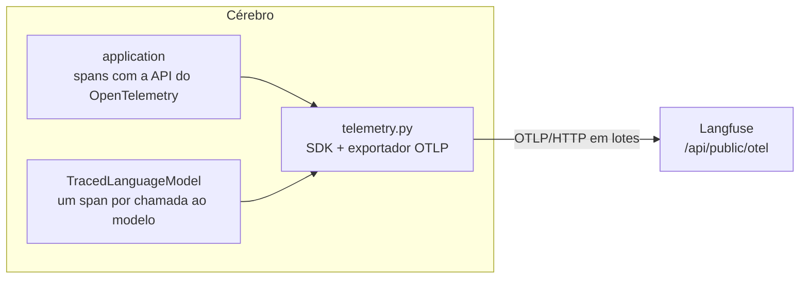

# Observabilidade

Cada passo do agente vira um trace do [OpenTelemetry](https://opentelemetry.io), visto num [Langfuse](https://langfuse.com) que roda no Docker, na própria máquina. Dá para abrir um ciclo e ver o prompt inteiro que o modelo leu, o que ele respondeu, quais ferramentas chamou, quantos tokens cada passo gastou e quanto tempo levou. Tudo grátis e local, desligado por padrão.

## Ligar

1. No `brain/.env`, troque para `TRACING_ENABLED=true`.
2. Rode o `.\start.ps1` como sempre. Ele vê a variável e sobe o Langfuse antes do cérebro. A primeira vez baixa as imagens e leva alguns minutos.
3. Abra http://localhost:3000 e entre com `capivara@example.com` e a senha `capivara-local`, criados na primeira partida.

Sem o `start.ps1` (Linux, macOS ou só o Langfuse):

```bash
docker compose -f compose.observability.yaml up -d      # sobe
docker compose -f compose.observability.yaml down       # para (os traces ficam nos volumes)
```

O Langfuse precisa de uns 2 a 3 GB de memória (web, worker, PostgreSQL, ClickHouse, Redis e MinIO). Por isso fica num compose separado do banco da memória, e só sobe quando o tracing está ligado. Só a porta 3000 fica aberta, e apenas para esta máquina (`127.0.0.1`).

As chaves `LANGFUSE_PUBLIC_KEY` e `LANGFUSE_SECRET_KEY` do `.env.example` são as que o compose cria no projeto. Para trocar, mude dos dois lados antes da primeira partida.

## O que aparece

| Trace (raiz) | Quando | Dentro dele |
|---|---|---|
| `autonomous_cycle` | Cada ciclo do modo vivo que roda (os pulados por falta de tokens não deixam trace) | A voz interior como entrada, o pensamento como saída, as chamadas do RAG e o turno da conversa |
| `creator_chat` | Cada resposta dela ao criador no mundo | A mensagem e a resposta. Todas as respostas de uma sessão compartilham o mesmo `session id`, então o Langfuse mostra a conversa inteira junta |
| `conversation_turn` | Cada mensagem no chat do terminal (e dentro dos dois acima) | Um span por chamada ao modelo e um por ferramenta, e o número de passos |

Os spans de dentro:

- **`chat qwen2.5:7b` / `complete_json qwen2.5:7b`** (tipo *generation*): as mensagens que o modelo leu, como um chat; a resposta com as chamadas de ferramenta; os tokens lidos e escritos; os parâmetros (temperatura, contexto); e as ferramentas oferecidas. Uma chamada que falha fica vermelha, com a exceção.
- **`execute_tool web_search`** e as outras (tipo *tool*): os argumentos e o resultado, sem o lembrete que vai junto para o modelo. Uma ferramenta que falha fica vermelha, mas o turno segue: o modelo lê o erro e pode se corrigir.

## Versão dos prompts

Cada arquivo de `brain/prompts/` ganha uma impressão digital curta do texto, e todas juntas formam a versão dos prompts, que aparece em todo span (campo *version* no Langfuse) e no log, na partida: `Tracing to Langfuse at ... (prompts version 3f9a...)`. Mudou um prompt, muda a versão. Filtrando por ela no Langfuse dá para comparar o antes e o depois. A impressão digital de cada prompt fica nos atributos do resource (`capybara.prompt.<nome>`), e o texto de cada versão fica no git. O porquê de não usar o gerenciamento de prompts do Langfuse está em [Decisões técnicas](decisoes.md#prompts-versionados-no-git-com-a-versão-em-cada-trace).

## Como funciona



- **A API e o SDK são separados.** O loop do agente, a conversa e o chat com o criador abrem spans com a API do OpenTelemetry (`opentelemetry-api`), que não faz nada enquanto nenhum SDK está instalado, como o `logging` sem configuração. Quem instala o SDK é `tracing_to_langfuse`, em `brain/src/infrastructure/telemetry.py`, no começo do `live_capybara` e do `chat_with_capybara`.
- **O modelo é medido por um decorator,** `TracedLanguageModel`, igual ao `MeteredLanguageModel` que conta os tokens do limite por hora. Com o tracing desligado, ele nem monta o JSON das mensagens.
- **Os spans saem em lotes,** numa thread em segundo plano (`BatchSpanProcessor`), por OTLP/HTTP, com as chaves do projeto como autenticação Basic. Se o Langfuse estiver fora do ar, o lote é descartado com um aviso no log. A capivara nunca para por causa do tracing. Ao encerrar, os últimos spans são enviados (com até 5 s de espera).
- **Os nomes dos atributos** seguem as [convenções GenAI do OpenTelemetry](https://opentelemetry.io/docs/specs/semconv/gen-ai/) (`gen_ai.request.model`, `gen_ai.usage.input_tokens`, `gen_ai.tool.name`...). Entrada, saída, tipo e sessão usam os nomes do Langfuse (`langfuse.observation.input`...), porque as convenções ainda não têm nome para um turno de agente. Todos ficam em `brain/src/application/tracing.py`.
- **Trocar de painel** é trocar o endereço do exportador: qualquer backend OTLP (Jaeger, Grafana Tempo, Arize Phoenix) recebe os mesmos spans.

## Testes

Os testes usam um tracer de verdade com um exportador em memória (`brain/tests/fakes/recorded_spans.py`) e conferem os spans: os nomes, quem é filho de quem, os atributos e os erros. Nenhum teste fala com o Langfuse.
